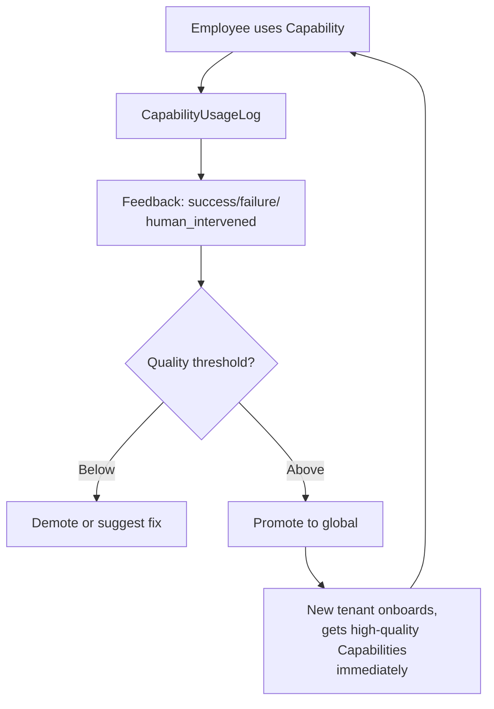

# For Enterprises

Need AI to land in your organization? SNAO is a multi-tenant agent platform that turns work into reusable knowledge and capabilities.

## 🎯 What Problem Does SNAO Solve?

Most enterprises face these challenges when deploying AI:

| Challenge | Typical Approach | SNAO Approach |
|---|---|---|
| **"Who can see what?"** | Ad-hoc permissions, hope the model doesn't leak | Governance Core: scope-based filtering **before** retrieval |
| **"Every question rebuilds context"** | Employees re-explain the same thing | Company Brain: knowledge precipitates from work sessions |
| **"Models hallucinate our policies"** | Prompt engineering + crossing fingers | Knowledge Engine: extract facts, vet quality, lifecycle management |
| **"Each team builds their own tools"** | Fragmented tools, no reuse | Capability Catalog: global + tenant capabilities with trust blocks |
| **"Can't audit what the AI did"** | Hope the logs tell the story | Event Journal: every action, every scope check, full lineage |

## 🏗️ What Is SNAO?

**SNAO** (Space-Native Agent Organization) is a **multi-tenant agent platform** where:

- Employees collaborate with Bots through natural language
- Knowledge and capabilities **precipitate during work** (not manually curated)
- Everything is governed: who saw what, who decided, full audit trail
- High-quality knowledge promotes to **global catalog** (desensitized, cross-tenant reuse)

**Technical distinguisher**: SNAO's value isn't in models, retrieval, or agent frameworks (those improve externally). It's in two things external tech can't replace:

1. **Governance** — Who can see what, who decides, auditable at every step
2. **Precipitation** — Knowledge and capabilities extracted from real work, continuously refined

## 🔄 How It Works

### The Company Brain (§8.2)

Your entire company shares **one Work Bot**. It answers each employee based on their **effective scope**:

```mermaid
graph LR
    A[Employee asks<br/>"What's the Q3 strategy?"] --> B{Scope Filter}
    B -->|Marketing team member| C[Shows marketing strategy]
    B -->|Sales lead| D[Shows sales + upstream context]
    B -->|CEO| E[Shows all enterprise-level strategy]
```

- **No manual permissions** — scope calculated from role + department + workspace
- **No data leakage** — filter applied **before** LLM sees anything
- **Auditable** — every answer records what scope was used

### Knowledge Precipitation (§6.2)

As people work, SNAO extracts reusable knowledge:

1. **Extract**: Knowledge Bot scans Event Journal for patterns
2. **Intake Confirmation**: Owner approves before it enters Company Brain (§8.2.2)
3. **Quality Control**: Semantic dedup, conflict detection, scoring
4. **Approval**: Platform vets quality (authority Task, §7.1)
5. **Live**: Knowledge available to effective scope

High-quality knowledge can promote to **global catalog** (desensitized) and benefit all tenants.

### Capability Flywheel (§9)



## 🧩 Capability System (§4)

SNAO manages all AI building blocks as **Capabilities**:

| Kind | Execution | Example |
|---|---|---|
| **Tool** | Executable (sandbox) | CRM connector, database query |
| **Skill** | RAG Adapter | Document summary, meeting notes |
| **Knowledge Pack** | Vector indexing | Industry SOPs, compliance rules |
| **External Role** | Gateway Bot | Lead capture, customer service |

Each capability has a **trust block** (§4.3):

```yaml
trust:
  execution_class: executable
  required_scopes: ["context:read", "crm:write"]
  egress: ["api.salesforce.com"]
  secret_refs: ["salesforce_api_key"]
  cost_profile:
    inference_cost: low
    task_tier: non_frontier
```

SNAO enforces this **at runtime** — no capability can exceed its declared permissions.

## 🛡️ Security & Governance (§6.1, §12)

### Six-Layer Isolation (§12.3)

1. **Network**: Tenant namespace, egress control
2. **Data**: PostgreSQL RLS + Schema per tenant
3. **Identity**: OIDC/SAML federation, scope-based RBAC
4. **Application**: Scope filter before every retrieval
5. **Deployment**: Resource quotas, HPA limits
6. **Observability**: Audit log, tenant-specific traces

Plus a 7th layer for **External Plane** (§8.3): Gateway Bot with outbound filtering for customer-facing interactions.

### Audit Everything (§12.1)

- Every retrieval: who, what scope, what was retrieved
- Every approval: who decided, what was the risk
- Every knowledge promotion: source tenant, desensitization log
- Cross-tenant operations: mandatory audit, requires super_admin

## 📦 Deployment Options (§2)

### Shared Cluster (Recommended)
- Managed by GoldenTellus
- Kubernetes + multi-tenant isolation
- Auto-scaling, monitoring, backups
- Start in days, not months

### Single-Tenant Appliance
- On-premise Mac mini host
- All data stays in your facility
- Control plane syncs via outbound HTTPS + mTLS
- Offline-tolerant (continues working if control plane unreachable)

Both run the **same codebase** — only deployment config differs.

## 💰 Pricing

Contact us for a quote. Pricing factors:

- **Tenant count** (shared cluster) or **appliance unit** (on-prem)
- **Active users** per tenant
- **Capability usage** (model calls, tool invocations)
- **Storage** (Context + Event Journal)

Free tier available for evaluation (1 tenant, 5 users, 30 days).

## 🚀 Get Started

### 1. Schedule a Demo

Contact: [待补充: 邮箱/日历链接/表单]

We'll show you:
- Company Brain answering scope-filtered questions
- Knowledge precipitating from a work session
- Capability being deployed with trust block enforcement
- Audit trail for a cross-department authorization

### 2. Pilot Program (30 days)

- Deploy SNAO for one department (5-10 users)
- Upload initial Context (product docs, SOPs, customer data)
- Work normally — knowledge precipitates automatically
- Review quality, audit logs, precipitation metrics

### 3. Production Rollout

- Expand to full organization
- Configure External Roles (customer-facing Bots)
- Set up tenant-specific Capabilities
- Monitor Capability Flywheel metrics

## 📚 Technical Deep Dive

Want to understand the architecture?

- **[SNAO Framework v1.0](https://github.com/GoldenTellus/goldentellus-home/blob/main/docs/snao-overview.md)** — Full technical specification
- **[Capabilities Catalog](https://github.com/GoldenTellus/goldentellus-capabilities)** — See what's already built
- **Case Studies** — Coming soon

## 🤝 Partner Program

Building AI solutions for enterprises? We offer:

- **Reseller program**: Deploy SNAO for your clients, keep margin
- **Integration support**: Integrate your SaaS with SNAO as a Tool capability
- **Co-development**: Build tenant-specific Capabilities together

Contact: [待补充]

---

**Next Steps**:
1. Schedule a demo (contact above)
2. Review the [SNAO technical overview](snao-overview.md)
3. Browse [open-source capabilities](https://github.com/GoldenTellus/goldentellus-capabilities) we've already extracted
