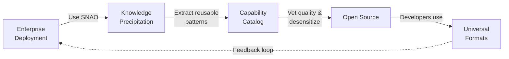

# GoldenTellus

  
GOLDENTELLUS

  
Production-ready AI capabilities, <strong>extracted from real enterprise deployments.</strong>

  
We deploy SNAO (multi-tenant agent platform) for enterprises, extract reusable capabilities, and open-source them for developers worldwide.

  

    <a class="md-button md-button--primary" href="capabilities.md">🧩 Browse Capabilities</a>
    <a class="md-button" href="for-developers.md">💻 Quick Start</a>
  

## 🎯 What We Do

  <a class="entry-card" href="for-developers.md">
    💻
    For Developers
    Use our capabilities in your projects. MCP, Claude Skill, OpenAPI, standalone — pick your format.
    Get started →
  </a>
  <a class="entry-card" href="for-enterprise.md">
    🏢
    For Enterprises
    Deploy SNAO: multi-tenant agent platform with governance, knowledge evolution, and capability precipitation.
    Learn about SNAO →
  </a>
  <a class="entry-card" href="capabilities.md">
    🧩
    Browse Capabilities
    Tools, skills, knowledge packs, and external roles — battle-tested in production.
    See catalog →
  </a>
  <a class="entry-card" href="https://github.com/GoldenTellus/goldentellus-capabilities.mdblob/main/CONTRIBUTING.md">
    🤝
    Contribute
    Have a production-tested capability? Share it with the community.
    Contribution guide →
  </a>

## 🔄 The Cycle: Deploy → Extract → Open Source

1. **Deploy**: We deploy SNAO in enterprises — a multi-tenant agent platform that handles governance, approval workflows, and knowledge evolution
2. **Precipitate**: During work, SNAO automatically extracts reusable capabilities from execution logs
3. **Vet & Generalize**: We review quality, desensitize enterprise-specific details, and package them in universal formats
4. **Open Source**: Developers worldwide can use these capabilities — no SNAO required

## 🧩 What's a Capability?

A **Capability** is a composable building block for AI applications:

| Type | Purpose | Example |
|---|---|---|
| **Tool** | Connect to external APIs | CRM lookup, database query, file operations |
| **Skill** | Orchestrate prompts + retrieval | Document summarization, meeting notes, data analysis |
| **Knowledge Pack** | Domain knowledge for RAG | Manufacturing SOPs, compliance rules, industry catalogs |
| **External Role** | Customer-facing bot persona | Lead capture, customer service, partner portal |

All capabilities are packaged in **universal formats** (MCP Server, Claude Skill, OpenAPI, standalone scripts) so you can use them in any environment.

## 🏗️ Behind the Scenes: SNAO

**SNAO** (Space-Native Agent Organization) is the platform that makes this possible. It's a multi-tenant agent platform with:

- **Governance Core**: Who can see what, who decides, full audit trail
- **Knowledge Engine**: Automatic extraction from work sessions, quality control, lifecycle management
- **Capability System**: Kind × Execution Class model with trust blocks and policy-based approval
- **Company Brain**: Single Work Bot entry for all employees, answers by effective scope

Learn more: [SNAO Overview](snao-overview.md)

## 📊 Current Status

- **Capabilities**: 0 public (first batch in progress)
- **Deployments**: 0 production (platform in development)
- **Contributors**: Open to the community

This is a **greenfield project**. We're building in public. Follow our progress on [GitHub](https://github.com/GoldenTellus).

## 🛡️ Our Principles

!!! note "Quality Over Quantity"
    We only open-source capabilities that have been deployed in production. No experiments, no demos, no "coming soon".

!!! tip "Universal Formats First"
    Every capability must work in at least one universal format (MCP, Claude Skill, OpenAPI, standalone). Developers shouldn't need SNAO to benefit.

!!! warning "Enterprise Trust"
    All open-sourced capabilities are desensitized and approved. We never leak customer data, trade secrets, or proprietary logic.
