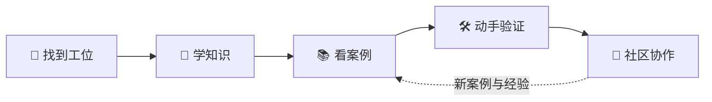

# 🗺️ 仓库与内容导航

GoldenTellus 目前保持精简：知识和案例都集中在本站，社群协作在 `goldentellus-community`。不知道去哪时，从你的目标开始选。

## 🚦 按需求直达

| 你的需求 | 第一站 | 推荐下一站 |
|---|---|---|
| 我是企业，想判断 AI 项目该不该做、先做什么 | 🏢 [企业入口](for-enterprise.md) | 📚 [案例库](cases/index.md) |
| 学习 FDE、规划成长 | 🌱 [新人入口](for-beginner.md) | 🧠 [流水线基础](knowledge/00-pipeline-fundamentals/index.md) |
| 了解 AI 落地案例 | 📚 [案例库](cases/index.md) | 🧠 [知识库](knowledge/index.md) |
| 深入某个工位的方法 | 🔧 [FDE 入口](for-fde.md) | 🧠 [知识库](knowledge/index.md) |
| 参与讨论、活动或组队 | 🤝 [goldentellus-community](https://github.com/GoldenTellus/goldentellus-community) | [贡献指南](CONTRIBUTING.md) |

## 🔁 按流水线串联

## 🏗️ 仓库

| 仓库 | 你会找到什么 |
|---|---|
| 🏠 [goldentellus-home](https://github.com/GoldenTellus/goldentellus-home) | 本站源码：总导航、受众入口、知识库、案例库 |
| 🤝 [goldentellus-community](https://github.com/GoldenTellus/goldentellus-community) | 治理、讨论、活动、成员和合作记录 |
| ⚙️ [`.github`](https://github.com/GoldenTellus/.github) | Organization Profile 与公共贡献约定 |

## 🧩 按工位查找

| 工位 | 知识库目录 |
|---|---|
| 流水线通识 | [00-pipeline-fundamentals](knowledge/00-pipeline-fundamentals/index.md) |
| Lead FDE / 协调 | [01-lead-fde](knowledge/01-lead-fde/index.md) |
| Analyst / 诊断 | [02-analyst](knowledge/02-analyst/index.md) |
| Architect / 架构 | [03-architect](knowledge/03-architect/index.md) |
| Builder / 开发 | [04-builder](knowledge/04-builder/index.md) |
| Data Engineer / 数据 | [05-data-engineer](knowledge/05-data-engineer/index.md) |
| Integrator / 集成 | [06-integrator](knowledge/06-integrator/index.md) |
| Ops / 运营 | [07-ops](knowledge/07-ops/index.md) |
| 跨工位 | [99-general](knowledge/99-general/index.md) |

## 🤝 想贡献什么？

- 文章、方法或岗位经验：提交到本仓库 `docs/knowledge/` 对应工位目录。
- 脱敏案例：用 [案例提交 Issue 模板](https://github.com/GoldenTellus/goldentellus-home/issues/new?template=case-submission.md) 先提交素材，审核后写入 `docs/cases/`。
- 讨论、活动或组队：到 `goldentellus-community`。

提交前请先阅读[贡献指南](CONTRIBUTING.md)。
