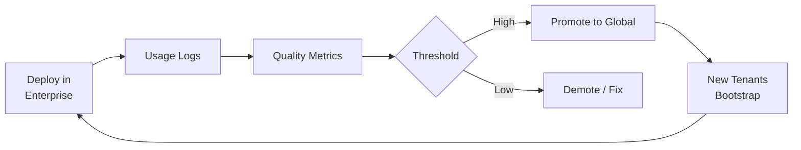

# SNAO Overview

**SNAO** (Space-Native Agent Organization) is a multi-tenant agent platform designed around two principles that external tech can't replace: **governance** (who can see what, who decides, auditable) and **precipitation** (knowledge and capabilities extracted from real work).

This page summarizes the architecture. For the full technical specification, see [SNAO_Framework_v1.0.md](https://github.com/GoldenTellus/goldentellus-home).

---

## Core Concept

> Models, retrieval, and agent frameworks improve externally. SNAO doesn't compete with them — it provides the governance layer and precipitation engine those technologies need to be deployable in enterprises.

- **Stable kernel** (governance + audit) that doesn't change with every new model release
- **Pluggable units** (18 types, §3.3) for LLM, embedding, retrieval, agent executor, etc.
- **Capability catalog** where both platform and tenants contribute reusable building blocks

---

## Key Subsystems

### 1. Governance Core (§6.1)

Deterministic rules engine — no model calls, only facts:

- **Authentication**: Enterprise SSO + platform operator roles
- **Event Journal**: Append-only log, tenant-partitioned, consent-filtered
- **Approval Flow**: Policy-based routing (auto / fast / strict)
- **Scope Calculation**: Computes effective scope **before retrieval** (§5.1.1)
- **Trust Enforcement**: Capabilities run within declared scopes, egress, secrets

### 2. Knowledge Engine (§6.2)

Semantic intelligence layer:

- **Extraction**: LLM-based candidate generation from Event Journal
- **Intake Confirmation**: Owner approval before entering Company Brain (§8.2.2)
- **Quality Control**: Dedup, conflict detection, scoring
- **Submission**: Platform approval (authority Task)
- **Promotion**: High-quality tenant knowledge → global catalog (desensitized)

### 3. Company Brain (§8.2)

Single Work Bot for entire enterprise:

- **Scope-filtered answers**: Each employee sees only what their role allows
- **Intake pipeline**: Knowledge candidates require owner confirmation before entry
- **Disclosure authorization**: Out-of-scope requests trigger approval Task (§8.2.4)
- **No admin backdoor**: Even admins' reads are scope-checked and audited

### 4. Capability System (§4)

Unified catalog of composable building blocks:

| Kind | Execution | Example |
|---|---|---|
| **Skill** | RAG + Template | Document summary, meeting notes |
| **Tool** | Gateway (sandbox) | CRM connector, database query |
| **Knowledge Pack** | RAG Indexing | Industry SOPs, compliance catalogs |
| **Model Profile** | Config | Cost-optimized routing, latency profiles |
| **External Role** | Gateway (outbound filtering) | Lead capture, customer service |

Each capability has a **trust block** declaring scopes, egress, secrets, and cost profile.

### 5. Task Queue (§7)

Human-in-loop unified as Tasks:

- **task_type**: `approval` / `human_action` / `bot_action`
- **reason**: `authority` / `judgment` / `capability_gap` / `ui_only` / `intake` / `disclosure` / `external_*`
- **Execution suspend/resume**: Bot hangs while waiting for human, resumes after Task completes

Policy routing:
- **auto**: Direct execution (low-risk declarative capabilities)
- **fast**: 4-hour SLA (credential binding, moderate-risk operations)
- **strict**: 24-hour SLA (new capability release, unknown egress)

### 6. Gateway Bot (§8.3)

DMZ layer for external interactions (customers, partners, other tenants):

- **Only reads Public Context** — never accesses internal Context
- **Dual-axis trust**: Trust level (anonymous → contracted) × Action level (inform → commit)
- **Outbound filtering**: Every message scanned for sensitive info, commitment detection
- **External Profile**: Progressive profiling, consent-gated, field-level encryption

---

## Tenant Isolation (§12)

Six-layer model:

1. **Network**: Kubernetes namespace per tenant, egress whitelist
2. **Data**: PostgreSQL RLS + Schema per tenant, Redis key prefix, MinIO bucket, Qdrant collection
3. **Identity**: SSO federation, RBAC + ABAC with scope calculation
4. **Application**: Scope filter before every retrieval, results re-checked after return
5. **Deployment**: ResourceQuota, HPA, sandbox limits
6. **Observability**: Tenant-tagged traces, cross-tenant ops mandatory audit

Plus **External Plane** (7th layer, §12.3): Gateway Bot entry with outbound audit.

---

## Deployment Model (§2)

### Shared Cluster (Multi-Tenant)
- One platform instance serves multiple tenants
- Tenant context injected per-request (JWT → RLS / Key prefix / Collection filter)
- Kubernetes namespace per tenant for sandbox + indexing workloads
- Platform manages: deployment, approval, monitoring, capability release

### Single-Tenant Appliance
- Mac mini on-premise, Docker Compose inside Linux VM
- Control plane sync via outbound HTTPS + mTLS (no inbound firewall rules)
- Offline-tolerant: Chat + local Tasks continue if control plane unreachable
- Data never leaves device (metrics + desensitized knowledge candidates only)

Both run **same code** — only `deployment_mode` config differs.

---

## Capability Flywheel (§9)

1. Tenants use capabilities
2. CapabilityUsageLog records success/failure/human_intervened
3. Quality score updates via §9.3 formula
4. High-scoring capabilities promote to global (after desensitization + approval)
5. New tenants onboard with mature global catalog

---

## Stable Kernel + Pluggable Units (§3.3)

**18 units**, each matching an independent technology curve:

| Group | Unit | Open Standard |
|---|---|---|
| Model | LLM, Embedding, Rerank | OpenAI API |
| Knowledge | Doc parsing, Retrieval, Extraction, Quality, Sensitive detection | Custom contracts |
| Execution | Agent executor, Intent/recommendation, Tool gateway, Sandbox | MCP, OpenAPI, gVisor |
| Interaction | Internal/external channels, Identity | OIDC, platform adapters |
| Infra | Object storage, Cache/queue, Observability | S3, OpenTelemetry |

Kernel calls units via version-controlled contracts. Replacing a unit = pass contract tests → gray release → full rollback if metrics degrade.

---

## Multi-Dimensional Model Routing (§4.9)

Three-step decision:

1. **Can we avoid calling a model?** (Deterministic filter / transform / monitor)
2. **Filter by latency**: `realtime` tasks (Chat, top-level orchestrator) need p50 < 1s + streaming
3. **Route by task tier**: `frontier` tasks get best model; `non_frontier` tasks get cheapest model that passes eval

Continuous降级: Run eval suites per capability, downgrade to smaller models when they pass.

---

## Security Highlights

- **No credential in manifest**: Secret refs only; actual secrets in Secret Vault
- **Egress whitelist enforced at runtime**: Sandbox + network policy, violations blocked
- **Sensitive detection: rules first**: Model-based detection only when rules can't decide
- **Cross-tenant audit mandatory**: Platform super_admins can't read tenant data without logged justification
- **External input untrusted**: Gateway Bot applies入站 injection detection + outbound sensitive filtering

---

## Next Steps

- **For Developers**: Browse [open-source capabilities](https://github.com/GoldenTellus/goldentellus-capabilities)
- **For Enterprises**: [Schedule a demo](for-enterprise.md)
- **Learn Interactively**: [SNAO Interactive Guide](https://github.com/GoldenTellus/goldentellus-snao-school) — a 12-lecture course you run in Claude Code
- **Technical Deep Dive**: Read [SNAO_Framework_v1.0.md](https://github.com/GoldenTellus/goldentellus-home) (full spec)
